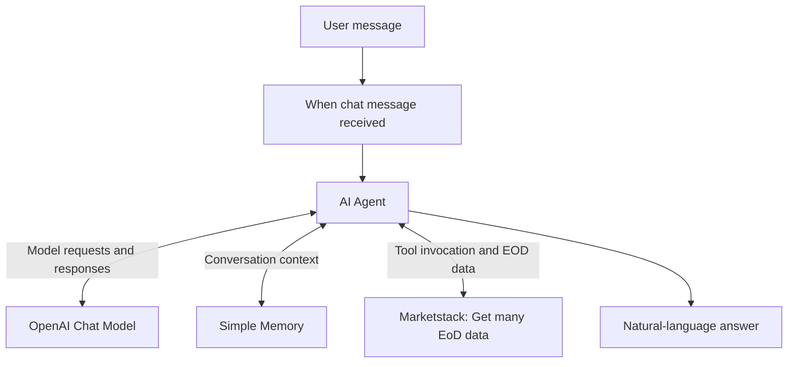

# Equity EOD AI Agent — n8n + OpenAI + Marketstack

**Status:** Tested learning prototype (one successful execution observed)  
**Focus:** Agentic AI · Tool calling · API integration · Conversational memory  
**Learning context:** Week 1, Day 1 of [AI Builder: Create Agents, Voice Agents & Automations in n8n](https://www.udemy.com/course/ai-builder-with-n8n-create-agents-voice-agents/), taught by Ed Donner.

## Overview

This project demonstrates an AI assistant that accepts natural-language questions about equity prices and retrieves historical **end-of-day (EOD)** market data through a tool connected to an n8n AI Agent.

Instead of asking the language model to recall stock prices from its training data, the workflow gives the agent a market-data retrieval tool. The model interprets the question and formats the returned data into a readable answer.

This is a learning project and **not a production trading or investment-advice application**.

## Architecture

| n8n component | Responsibility |
| --- | --- |
| **When chat message received** | Starts the workflow from a chat message. |
| **AI Agent** | Interprets the request, calls the available tool when appropriate, and produces the final answer. |
| **OpenAI Chat Model** | Supplies the language model used by the agent. |
| **Simple Memory** | Maintains conversational context within the session. |
| **Get many EoD data in Marketstack** | Retrieves equity end-of-day data from an external financial-data API. |

The workflow was built visually in n8n; no custom application code is required for the demonstrated interaction.

## Demonstrated behavior

**Test prompt**

> Qual o end of day equity price for Google?

**Observed answer in the n8n chat** (for October 30, 2026):

| Symbol | EOD close returned by the workflow |
| --- | ---: |
| `GOOGL` | USD 279.84 |
| `GOOG` | USD 278.22 |

These values document **what the recorded workflow returned**; they have not been independently verified against an exchange or a second data provider. They are not live quotes.

The Marketstack tool's visible response included structured fields such as `open`, `high`, `low`, `close`, `volume`, and adjusted-price fields.

### Execution evidence

The successful n8n execution shown in the original test had:

- **Overall duration:** approximately 6.88 seconds.
- **Token usage shown in the log:** approximately 421 tokens.
- **Selected Marketstack tool call:** approximately 480 milliseconds.
- **Execution log:** repeated calls to the chat model, memory, and Marketstack tool.

These are observations from **one run**, not a performance benchmark or guarantee.

## How to recreate the workflow

### Prerequisites

- An n8n instance (Cloud or self-hosted) that supports AI Agent nodes.
- Access to the OpenAI API with valid API credentials.
- Access to Marketstack and credentials appropriate for its EOD endpoint.
- Permission to use the chosen services under their current pricing and rate limits.

### Steps

1. Create a new workflow in n8n.
2. Add **When chat message received** as the trigger.
3. Connect the trigger to an **AI Agent** node.
4. Attach an **OpenAI Chat Model** to the agent's required **Chat Model** port. Configure the API credential in n8n's credential manager.
5. Attach **Simple Memory** to the agent's **Memory** port and configure session handling for the chat.
6. Add **Get many EoD data in Marketstack** as a tool connected to the agent's **Tool** port.
7. Configure the Marketstack credential and the ticker input used by the tool. Confirm that the tool receives the intended equity symbol.
8. Open the n8n chat, ask for the end-of-day price of an equity, and inspect the execution logs and returned data.
9. Confirm the agent uses the tool and that the final answer is consistent with the tool's output.

> **Reproducibility note:** This document describes the observed node architecture and a high-level reconstruction procedure. The exact node parameters and an importable n8n workflow JSON have **not yet been supplied**, so this is not presented as a one-click import or a fully reproducible export.

## Engineering considerations

**Security**

- Store API keys in n8n credentials, not in prompts, workflow descriptions, Git commits, or screenshots.
- Review exported workflow JSON for secrets, personal information, and sensitive execution data before publication.
- Prefer scoped credentials and monitor usage/costs.

**Data quality**

- EOD information is historical and should not be described as real-time.
- Check the trading date, exchange, currency, symbol, and corporate-action adjustment rules before interpreting a result.
- Distinguish reported API results from model-generated commentary.

**Reliability**

- Free and paid API services can impose rate limits or return missing or delayed data.
- Handle unknown tickers, empty datasets, API errors, and ambiguous questions explicitly before production use.
- Validate important outputs against the underlying structured data.

## Testing and validation

See the [test plan](docs/test-plan.md). It distinguishes the one observed smoke test from unexecuted checks for ambiguous symbols, API errors, source attribution, missing data, and credential hygiene.

## Next improvements

- [ ] Add ticker validation and clarification for ambiguous company names.
- [ ] Return the market date, currency, and data source alongside every price.
- [ ] Add explicit error handling and rate-limit behavior.
- [ ] Define structured output formatting and regression tests.
- [ ] Export and sanitize the n8n workflow JSON for reproducibility.
- [ ] Add a redacted workflow screenshot (exclude session identifiers or confidential data).

## Scope and attribution

This case study documents **my hands-on implementation and test** from the course's first day. It is not a transcript or a reproduction of the instructor's teaching materials.

**Tools:** [n8n](https://n8n.io/) · [OpenAI API](https://platform.openai.com/) · [Marketstack](https://marketstack.com/)
