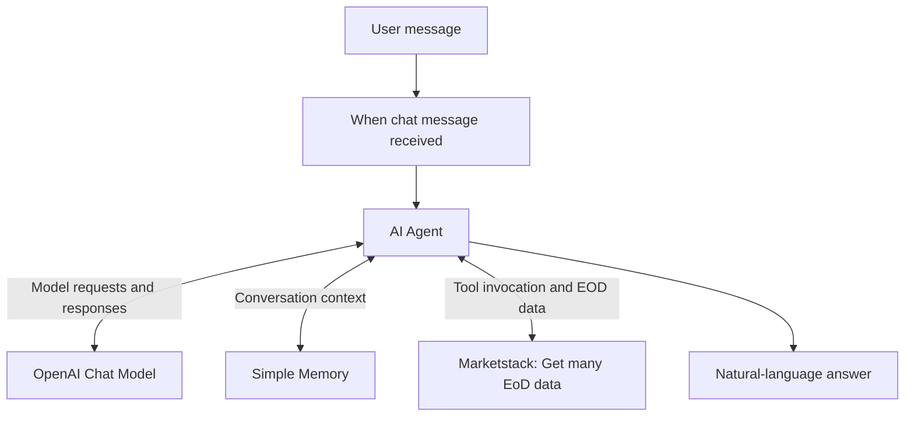

# Equity EOD AI Agent — n8n + OpenAI + Marketstack

**Status:** Tested learning prototype (one successful execution observed)  
**Focus:** Agentic AI · Tool calling · API integration · Conversational memory  

## Overview

I built this prototype to explore how an AI assistant can accept natural-language questions about equity prices and retrieve historical **end-of-day (EOD)** market data through a tool connected to an n8n AI Agent.

Instead of asking the language model to recall stock prices from its training data, the workflow gives the agent a market-data retrieval tool. The model interprets the question and formats the returned data into a readable answer.

This is a learning project and **not a production trading or investment-advice application**.

## Architecture

| n8n component | Responsibility |
| --- | --- |
| **When chat message received** | Starts the workflow from a chat message. |
| **AI Agent** | Interprets the request, calls the available tool when appropriate, and produces the final answer. |
| **OpenAI Chat Model** | Supplies the language model used by the agent. |
| **Simple Memory** | Maintains conversational context within the session. |
| **Get many EoD data in Marketstack** | Retrieves equity end-of-day data from an external financial-data API. |

I built the workflow visually in n8n; no custom application code is required for the demonstrated interaction.

## Context and tool execution

I am documenting how context and tool execution work, along with settings I still want to verify. These notes do not add new test results.

### Agent loop

1. n8n supplies the model with the system message, user request, available tool definitions, and relevant conversation context.
2. The model returns an answer or requests a tool with arguments.
3. n8n executes the requested Marketstack operation.
4. n8n passes the tool result back to the model.
5. The model produces the final answer or requests another tool operation.

The model requests the action; the surrounding workflow executes it. Simple Memory supplies conversation context to subsequent model calls. An isolated model call does not itself retain the previous conversation, and the available history depends on the memory configuration.

### Proposed configuration to verify

I want to verify model-defined ticker input and the **Latest** filter set to **Yes** in the actual workflow. Latest available EOD data is not a real-time quote.

A [proposed system prompt](docs/system-prompt.md) defines Portuguese responses, tool use, source attribution, and missing-data behavior. I still need to apply it and validate the resulting behavior.

### Inspect an execution

Open the workflow's **Executions** view and inspect the agent, chat model, memory, and tool details available for the selected run:

- Confirm the system message and user request supplied to the model.
- Check whether the relevant earlier messages are present in the context.
- Inspect the requested ticker and the tool configuration used for the EOD lookup.
- Compare the returned ticker, date, currency where available, and close with the final answer.
- Record errors or missing fields rather than inferring successful behavior from fluent text.

The instance-level **Executions** view provides access to runs across workflows. UI labels may vary by version.

### Keep the architecture measurable

Start with this single-agent workflow. Add chained model calls or separate agents only when comparisons show better outcomes. A chain passes one call's output into the next call; an agent loop selects tool actions based on the task and accumulated results. Compare correctness, appropriate tool use, response time, and cost on the same test cases before choosing a more complex design or a different reasoning configuration.

## Exploring a Google Sheets portfolio integration

**Status: proposal.** I have not implemented or tested this extension. My recorded EOD lookup remains the only documented execution for this case.

### Problem and intended value

The current prototype answers a price question in chat. A portfolio maintained manually requires copying those results into a sheet. The proposed extension reads portfolio rows, obtains the latest available EOD close, and writes it back to the matching row. The intended benefit is less manual copying; time savings and accuracy improvements have not been measured.

### Proposed tool configuration

Retain the chat trigger, AI Agent, chat model, and Simple Memory. Connect three tools to the agent:

| Tool | Proposed configuration | Allowed role |
| --- | --- | --- |
| Google Sheets read | Select a fixed test document and sheet; get rows | Read `ticker`, `quantity`, and `price` |
| Marketstack lookup | EOD data; Get Many; model-defined ticker; Latest enabled | Retrieve the latest available EOD record |
| Google Sheets update | Same fixed document and sheet; Update Row; match on `ticker` | Supply the matching ticker and update `price`; exclude `quantity` from writable fields |

I still need to verify these configuration notes in my n8n environment and configure Google authorization. I have not published an importable workflow for this extension.

### Data contract and expected sequence

Use explicit symbols such as `GOOGL`, `AAPL`, and `TSLA` in a synthetic test sheet, with one unique ticker per row. These are sample inputs, not portfolio holdings.

1. Read the selected sheet and identify the rows to update.
2. Retrieve the latest available EOD data for each valid symbol.
3. Confirm that the returned symbol matches the requested row and that a usable close exists.
4. Write the returned `close` to `price`, matching the existing ticker. Preserve quantities and other rows.
5. Report successful updates, skipped rows, failures, and the source market dates.

Symbol validation, duplicate detection, and failure handling are **additional proposed acceptance requirements**, not behaviors demonstrated in this project. Do not replace an existing price with a guess, zero, or an empty value on lookup failure. A partial failure should be reported as partial completion.

The field `price` means the selected record's EOD close, not a live quote. Preserve the returned market date and currency, where available, in the execution evidence. Persisting `market_date`, `currency`, and `updated_at` in extra columns is a future extension. High/low columns are another possibility outside my initial scope.

### Validation and delivery

Start with a separate test sheet. Inspect each tool's input and output in JSON or table view, then compare the API close with the updated cell. Capture redacted before/after sheet values and the execution trace. I will record actual invocation counts from execution traces.

Run the Sheets scenarios in the [test plan](docs/test-plan.md). Export and sanitize the workflow only after configuration and validation. No Google Sheets connection, workflow export, sheet write, or performance result is claimed by this documentation update.

## Demonstrated behavior

**Test prompt**

> Qual o end of day equity price for Google?

**Observed answer in the n8n chat** (for October 30, 2026):

| Symbol | EOD close returned by the workflow |
| --- | ---: |
| `GOOGL` | USD 279.84 |
| `GOOG` | USD 278.22 |

These values document **what the recorded workflow returned**; they have not been independently verified against an exchange or a second data provider. They are not live quotes.

The Marketstack tool's visible response included structured fields such as `open`, `high`, `low`, `close`, `volume`, and adjusted-price fields.

### Execution evidence

The successful n8n execution shown in the original test had:

- **Overall duration:** approximately 6.88 seconds.
- **Token usage shown in the log:** approximately 421 tokens.
- **Selected Marketstack tool call:** approximately 480 milliseconds.
- **Execution log:** repeated calls to the chat model, memory, and Marketstack tool.

These are observations from **one run**, not a performance benchmark or guarantee.

## How to recreate the workflow

### Prerequisites

- An n8n instance (Cloud or self-hosted) that supports AI Agent nodes.
- Access to the OpenAI API with valid API credentials.
- Access to Marketstack and credentials appropriate for its EOD endpoint.
- Permission to use the chosen services under their current pricing and rate limits.

### Steps

1. Create a new workflow in n8n.
2. Add **When chat message received** as the trigger.
3. Connect the trigger to an **AI Agent** node.
4. Attach an **OpenAI Chat Model** to the agent's required **Chat Model** port. Configure the API credential in n8n's credential manager.
5. Attach **Simple Memory** to the agent's **Memory** port and configure session handling for the chat.
6. Add **Get many EoD data in Marketstack** as a tool connected to the agent's **Tool** port.
7. Configure the Marketstack credential and the ticker input used by the tool. Confirm that the tool receives the intended equity symbol.
8. Open the n8n chat, ask for the end-of-day price of an equity, and inspect the execution logs and returned data.
9. Confirm the agent uses the tool and that the final answer is consistent with the tool's output.

> **Reproducibility note:** I still need to publish exact node settings and a reviewed workflow JSON. For now, I document the architecture and reconstruction steps.

## Engineering considerations

**Security**

- Store API keys in n8n credentials, not in prompts, workflow descriptions, Git commits, or screenshots.
- Review exported workflow JSON for secrets, personal information, and sensitive execution data before publication.
- Prefer scoped credentials and monitor usage/costs.

**Data quality**

- EOD information is historical and should not be described as real-time.
- Check the trading date, exchange, currency, symbol, and corporate-action adjustment rules before interpreting a result.
- Distinguish reported API results from model-generated commentary.

**Reliability**

- Free and paid API services can impose rate limits or return missing or delayed data.
- Handle unknown tickers, empty datasets, API errors, and ambiguous questions explicitly before production use.
- Validate important outputs against the underlying structured data.

## Testing and validation

See the [test plan](docs/test-plan.md). It distinguishes the one observed smoke test from unexecuted checks for ambiguous symbols, API errors, source attribution, missing data, and credential hygiene. I have planned checks for memory recall, system-prompt adherence, tool selection, tool parameters, and response traceability; none of those new checks has been executed.

I also plan checks for sheet reads, row matching, quantity preservation, failure handling, and output traceability (T14–T20); these checks have not been executed.

## Next improvements

- [ ] Configure the proposed Sheets tools against a synthetic Google Sheet and run T14–T20.
- [ ] Apply and validate the proposed system prompt.
- [ ] Verify model-defined ticker input and the Latest EOD filter in the actual workflow.
- [ ] Execute and document the context and tool acceptance scenarios (T09–T13).

- [ ] Add ticker validation and clarification for ambiguous company names.
- [ ] Return the market date, currency, and data source alongside every price.
- [ ] Add explicit error handling and rate-limit behavior.
- [ ] Define structured output formatting and regression tests.
- [ ] Export and sanitize the n8n workflow JSON for reproducibility.
- [ ] Add a redacted workflow screenshot (exclude session identifiers or confidential data).

## Where I am

I built and tested the EOD lookup prototype. I am using these notes to explore clearer prompts, more traceable answers and a possible Sheets integration. The proposed settings and additional acceptance checks still need validation.

**Tools:** [n8n](https://n8n.io/) · [OpenAI API](https://platform.openai.com/) · [Marketstack](https://marketstack.com/)
