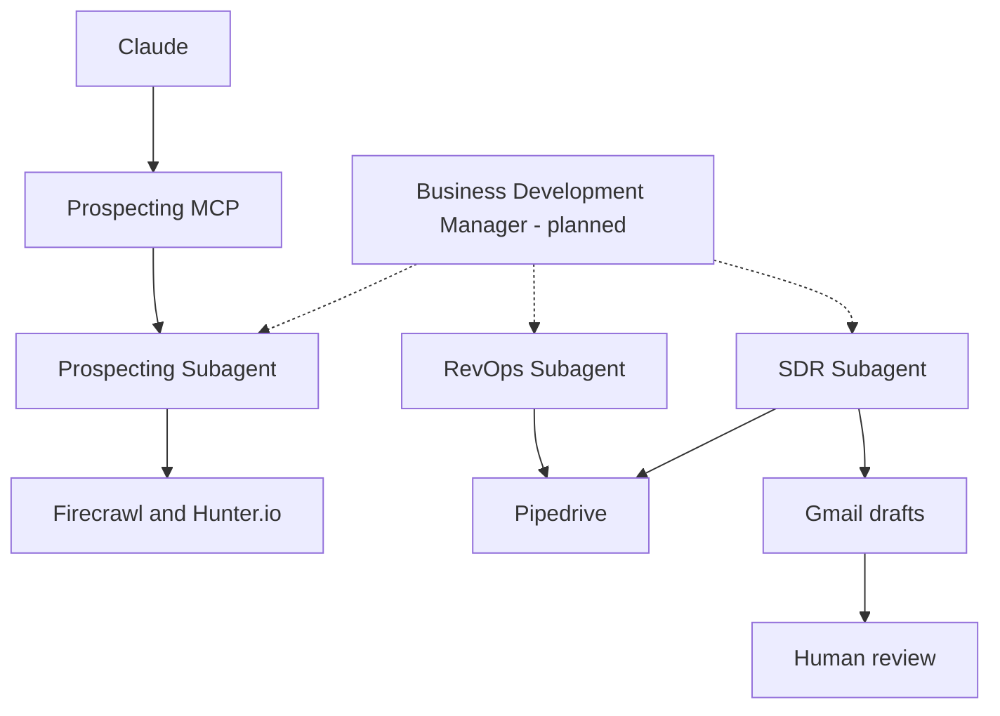

# AMPLIFY — Agentic AI Sales & Business Development Automation

**Project 11 · Phase I implemented, tested and published; Phase II components implemented and functionally tested.**

**Stack:** n8n · OpenAI · Firecrawl · Hunter.io · MCP · Streamable HTTP · Claude · Pipedrive · Gmail · Structured Output Parser

## Business objective

I implemented a modular platform to reduce manual prospect research, CRM administration and preparation of outbound sales communications. The goal is to improve commercial capacity without proportionally increasing operational effort.

## Phase I — AI prospecting and MCP integration

I implemented a prospecting agent with Firecrawl and Hunter.io MCP clients, a structured JSON output targeting five prospects per query, and a reusable subagent. I published a separate MCP server workflow and tested its production endpoint from Claude.

## Phase II — Business development and revenue operations

I extended the architecture with independently tested RevOps and SDR workflows:

| Component | Responsibility |
| --- | --- |
| Prospecting Subagent | Research, contact discovery and email verification |
| RevOps Subagent | Extract structured lead data and create linked organization, person and lead records in Pipedrive |
| SDR Subagent | Retrieve CRM contacts and create personalised HTML Gmail drafts |
| Business Development Manager | Planned central coordination |

I chose structured outputs and deterministic CRM nodes for dependent data writes, retaining agent-controlled tools for prospect research and drafting. This limits unnecessary autonomy and helps keep each agent's context focused.

## Testing and refinement

I inspected the creation and association of CRM records in Pipedrive. In the SDR workflow, the initial draft contained unsupported product features and lacked the recipient address. I refined the prompt and configured the recipient mapping, then reran the workflow and inspected the corrected Gmail draft.

I restricted the agent to draft creation rather than sending, retaining human review as a security control against inappropriate disclosure and outbound communication. This reduces risk but does not eliminate prompt injection.

## Delivery and evidence

The implementation, testing and deployment were performed by the project owner. Phase I's published MCP endpoint and Claude integration are described in the reference material. Phase II's independent functional runs are described; separate publication records, original workflow exports and logs are not included. Central manager orchestration, large-scale tests, deduplication and measured revenue impact remain outside the demonstrated scope.

## Technical documentation

- [AMPLIFY repository](https://github.com/wagner-stoffel/amplify) — project evolution and Phase I implementation.
- [Phase II technical case study](https://github.com/wagner-stoffel/amplify/blob/main/docs/business-development-revops-sdr.md) — context engineering, CRM mappings, SDR configuration, test outcomes and security.

[Back to portfolio](../../README.md)
