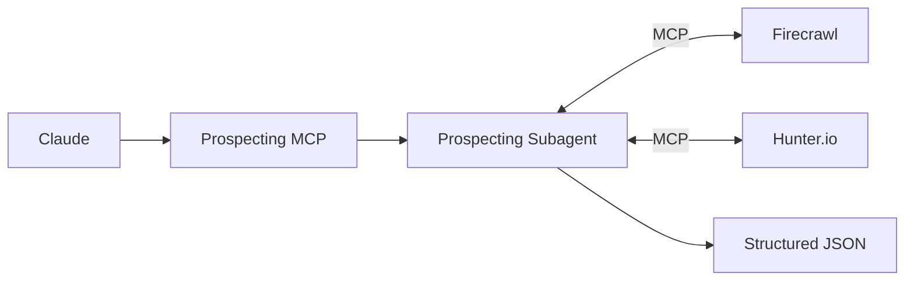

# AMPLIFY — AI-Powered Sales Prospecting & MCP Integration

**Project 11 · Implemented, tested and published (author-reported)**

**Stack:** n8n · OpenAI · Firecrawl · Hunter.io · MCP · Streamable HTTP · Claude · Structured Output Parser

## Business objective

I implemented a reusable B2B sales-prospecting service that interprets natural-language requests, identifies relevant companies and decision-makers, and returns structured contact candidates with qualification rationales.

## Delivery

I built a chat-based AI Agent, integrated Firecrawl for web research and Hunter.io for professional contact discovery and verification, and configured a structured JSON response targeting five leads per query. After functional testing, I refactored the agent into a callable **Prospecting Subagent**, published a separate **Prospecting MCP** server workflow and connected the production endpoint to Claude.

## Architecture

## Validation and outcomes

The testing scenarios covered web search and scraping, contact enrichment, output structure, workflow invocation and remote end-to-end execution from Claude. The architecture separates the external interface from the prospecting logic and allows the model to select tools dynamically.

The author reports completing the implementation, testing and deployment. Exact execution counts, email accuracy, business outcomes and production hardening are not independently verified. This case documents a hands-on implementation based on a guided reference architecture; original workflow exports and log evidence are not included.

## Technical documentation

[AMPLIFY project repository](https://github.com/wagner-stoffel/amplify) — architecture, configuration, test scenarios, deployment, limitations and sample output contract.

[Back to portfolio](../../README.md)
